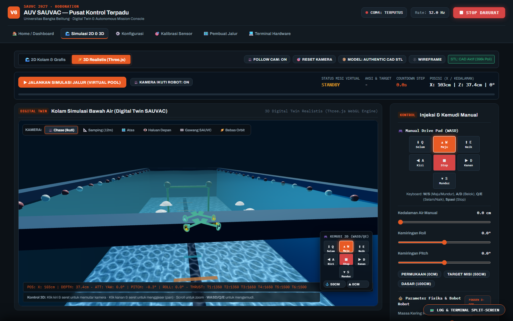
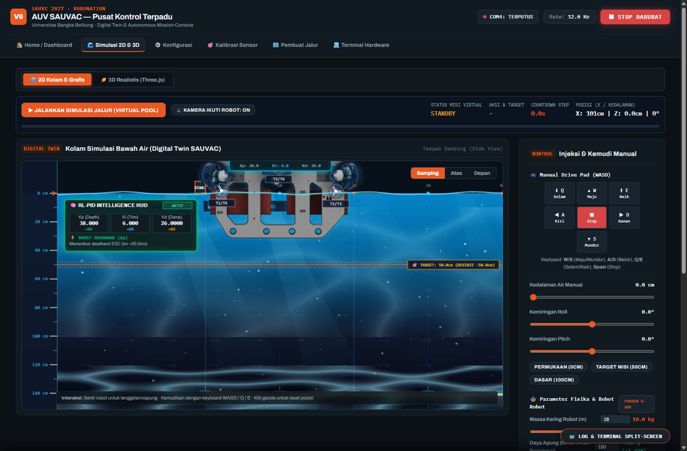
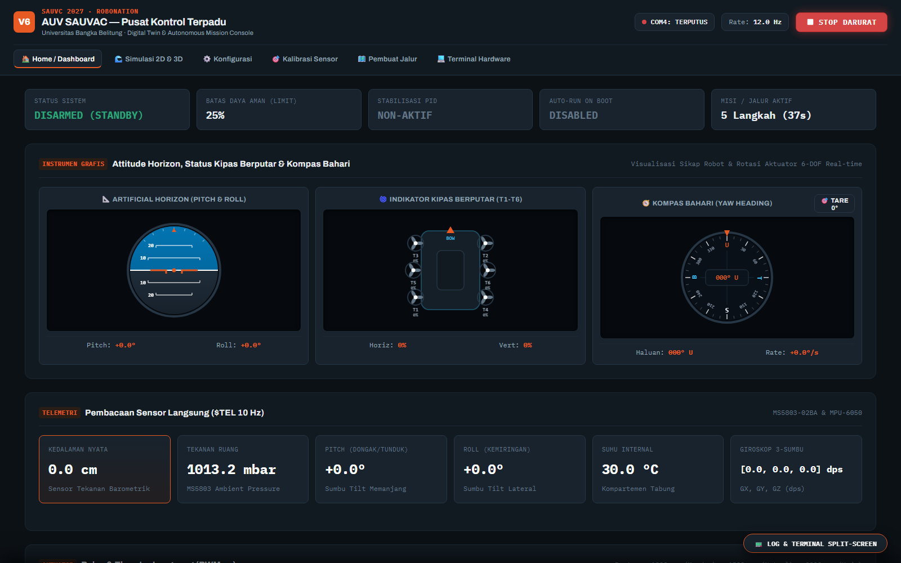
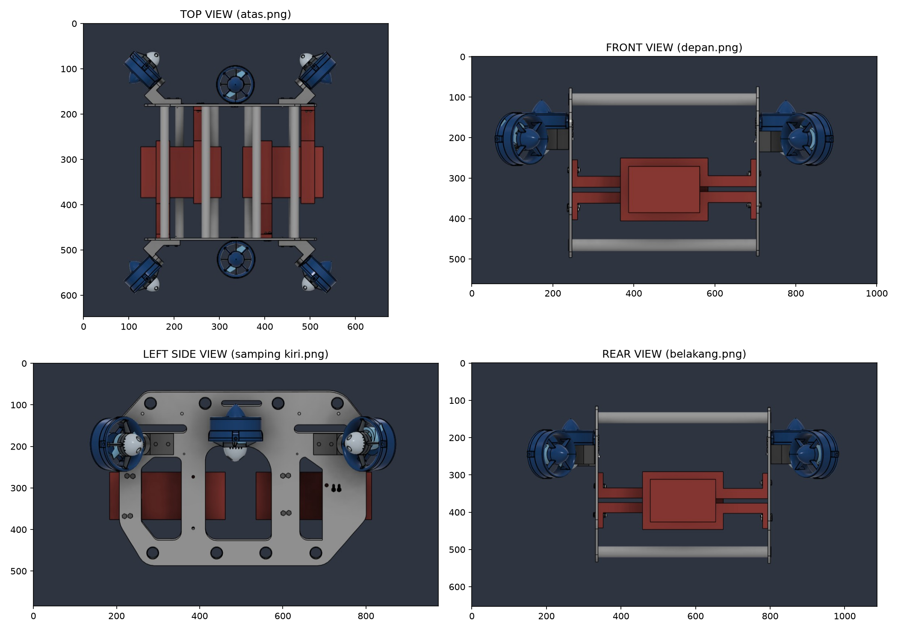

# AUV SAUVAC — Kendali Presisi 6-Thruster & Digital Twin Bawah Air

<div align="center">

[-C51A4A?style=for-the-badge&logo=raspberrypi&logoColor=white)](https://www.raspberrypi.com/products/raspberry-pi-pico/)
[](https://sauvc.org/)
[](simulasi_auv/)
[](simulasi_auv/)
[-orange?style=for-the-badge&logo=platformio&logoColor=white)](firmware/)

**Pusat Kendali Presisi 6-Thruster & Simulator Digital Twin Bawah Air**

---

### 🌐 Bahasa
[**English**](README.md) • **Bahasa Indonesia**

---

</div>

## 📸 Galeri Visual

<div align="center">

| 3D Digital Twin (Three.js & CAD Mesh) | Model Gerak 2D Eksperimental Tereduksi |
| :---: | :---: |
|  |  |

| Industrial Web Dashboard & Telemetry | Authentic CAD Projections |
| :---: | :---: |
|  |  |

</div>

---

### Daftar Isi
- [Ringkasan Sistem](#ringkasan-sistem)
- [Fitur Utama](#fitur-utama)
- [Pinout Hardware & Geometri 6-Thruster](#pinout-hardware--geometri-6-thruster)
- [Panduan Simulator Digital Twin](#panduan-simulator-digital-twin)
- [Panduan Bench Hardware-in-the-Loop](docs/guides/HIL_GUIDE.md)
- [Referensi Perintah Serial CLI](#referensi-perintah-serial-cli)
- [Format Misi Otonom (`/jalur.json`)](#format-misi-otonom-jalurjson)
- [Alat Pengujian & Flashing](#alat-pengujian--flashing)
- [Struktur Direktori Repositori](#struktur-direktori-repositori)

---

## 📌 Ringkasan Sistem
Proyek ini mengimplementasikan arsitektur kontrol ganda (*dual-rate control*):
1. **Loop Kontrol Tertanam (RP2040, nominal 50 Hz / 20 ms):** Firmware C++ membangkitkan PWM, membaca sensor MPU-6050/MS5803, menjalankan loop PID yang tersedia, dan mengeksekusi misi LittleFS tanpa ketergantungan jaringan host. Timing dan perilaku aktuator tetap harus diverifikasi pada hardware target.
2. **Companion Simulator (Host PC / Port 8080):** Digital twin eksperimental berbasis web untuk visualisasi dan pengujian perangkat lunak; model tereduksi ini bukan model Fossen tervalidasi atau bukti keselamatan perangkat keras. Server hanya menerima koneksi lokal.

---

## 🌟 Fitur Utama
1. **Loop Kontrol Nominal 50 Hz:** Firmware dikonfigurasi untuk periode kontrol 20 ms; ini bukan sertifikasi timing maupun keselamatan hardware.
2. **Konfigurasi Vektor 6-Thruster:** 4 thruster horizontal untuk surge, sway, dan yaw; dua thruster vertikal untuk heave dan roll sesuai matriks mixer firmware. Pitch control dinonaktifkan sampai geometri dan kewenangan aktuator diverifikasi secara fisik.
3. **Model Simulasi Eksperimental:** Model digital twin tereduksi untuk visualisasi dan uji perangkat lunak. Hasilnya bukan validasi hidrodinamika atau dasar untuk tuning perangkat keras.
4. **Stabilisasi PID:** Kontrol aktif untuk *Depth Hold* dan *Roll leveling*; pitch tidak didukung.
5. **Mesin Misi LittleFS:** Membaca skenario `/jalur.json` dengan dukungan istilah navigasi bahasa Indonesia (`selam`, `maju`, `mundur`, `putar`, `kiri`, `kanan`, `hover`, `naik`).
6. **Proteksi & Failsafe:** Pembatasan daya default **25%**, validasi sensor sebelum misi/PID, dan penghentian misi saat telemetri injeksi simulasi hilang (>500 ms).

> **Perlu validasi hardware:** Rotasi/polaritas thruster pada tabel adalah konfigurasi default firmware, bukan arah dorong yang sudah diverifikasi secara fisik. Lepas propeler saat pemeriksaan arah awal dan gunakan pemutus daya fisik independen.

---

## 🔌 Pinout Hardware & Geometri 6-Thruster

```text
                    ▲ [HALUAN / DEPAN]
                    │
      [T3: Depan-Kiri]  ╲            ╱ [T2: Depan-Kanan]
         (GP4, CCW)      ╲          ╱     (GP3, CW)
                          ┌────────┐
        [T6: Vert-Kiri]   │ RP2040 │  [T5: Vert-Kanan]
          (GP7, CCW)      │ PICO W │     (GP6, CW)
                          └────────┘
      [T1: Belakang-Kiri]╱          ╲ [T4: Belakang-Kanan]
          (GP2, CW)     ╱            ╲    (GP5, CCW)
                    │
                    ▼ [BURITAN / BELAKANG]
```

| Komponen / Aktuator | GPIO RP2040 | Polaritas / Putaran | Fungsi / Peran |
| :--- | :---: | :---: | :--- |
| **Thruster 1 (T1)** | **GP2** | CW (Reverse: 1) | Vektor horizontal belakang-kiri (45°), surge/yaw |
| **Thruster 2 (T2)** | **GP3** | CW (Reverse: 1) | Vektor horizontal depan-kanan (45°), surge/yaw |
| **Thruster 3 (T3)** | **GP4** | CCW (Reverse: 0) | Vektor horizontal depan-kiri (45°), surge/yaw |
| **Thruster 4 (T4)** | **GP5** | CCW (Reverse: 0) | Vektor horizontal belakang-kanan (45°), surge/yaw |
| **Thruster 5 (T5)** | **GP6** | CW (Reverse: 0) | Vektor vertikal tengah-kanan, heave/depth, roll |
| **Thruster 6 (T6)** | **GP7** | CCW (Reverse: 1) | Vektor vertikal tengah-kiri, heave/depth, roll |
| **I2C SDA** | **GP26** | Standar I2C Wire1 | Sensor MPU-6050 (0x68) & MS5803 (0x76) |
| **I2C SCL** | **GP27** | Standar I2C Wire1 | Sensor MPU-6050 (0x68) & MS5803 (0x76) |
| **Serial CLI / Telemetri** | **USB** | 115200 baud, 8-N-1 | Terminal interaktif & paket mesin `$TEL`/`$INJ` |

---

## 🌊 Panduan Simulator Digital Twin
Folder `simulasi_auv/` berisi web server terpadu dan antarmuka Three.js 3D:
```bash
# Jalankan simulator
cd simulasi_auv

# Opsi 1 (Windows Batch):
start.bat

# Opsi 2 (Python Langsung):
python app.py
```
Buka browser pada **`http://localhost:8080`**. Antarmuka menyediakan 6 tab kontrol:
* **🏠 Home / Dashboard:** Telemetri live (kedalaman, sudut pitch/roll, pulsa 6 motor, status arming).
* **🌊 Simulasi 2D & 3D:** Kolam lomba Three.js ($12\text{m} \times 5\text{m} \times 2\text{m}$) dengan gawang pipa PVC, kaustik animasi, panah gaya dorong, dan visualisasi gerak planar tereduksi eksperimental.
* **⚙️ Konfigurasi:** Pengaturan limit daya, deadband ESC, reverse thruster, dan gain PID.
* **🎯 Kalibrasi Sensor:** Tare nol kedalaman air dan perataan sudut IMU level.
* **🗺️ Pembuat Jalur:** Desain lintasan misi visual dengan upload langsung via serial ke LittleFS.
* **💻 Terminal Hardware:** Terminal serial ANSI langsung ke mikroprosesor RP2040.

Launcher konfigurasi `start_konfigurasi.bat` membuka tab **Konfigurasi** di aplikasi terpadu pada **`http://localhost:8080/#konfigurasi`**. Halaman lama `config.html` mengalihkan ke tab tersebut; server legacy di port 8081 tidak lagi digunakan. Aplikasi hanya bind ke loopback. Lepas propeler dan gunakan pemutus daya fisik independen untuk prosedur bench.

Untuk setup melalui Wi-Fi, firmware menyediakan **AP + kanal UDP JSON** serta endpoint update HTTP terautentikasi. Server Python pada dashboard hanya meneruskan file firmware Pico W `.bin`; firmware OTA-capable harus dipasang pertama kali lewat USB/BOOTSEL. Upload OTA berikutnya memerlukan password AP, ruang staging LittleFS, perangkat idle/disarmed, dan Auto-Run nonaktif. Perintah/status berhenti sementara ketika image ditulis dan Pico restart. UF2 tetap digunakan untuk pemulihan lewat BOOTSEL. Aplikasi Android di [`android-config/`](android-config/README.md) tetap menggunakan UDP. Sebelum build, salin `src/wireless_secrets.example.h` menjadi `src/wireless_secrets.h` dan isi password privat 12–63 karakter; fitur Wi-Fi nonaktif tanpa password lokal. Setup/update ini hanya untuk penggunaan bench di atas air, bukan kontrol bawah air atau emergency stop. Lihat [ANDROID_PARAMETER_APP_PROMPT.md](docs/development/ANDROID_PARAMETER_APP_PROMPT.md) untuk detail protokol dan [panduan OTA Arduino-Pico](https://arduino-pico.readthedocs.io/en/latest/ota.html) untuk model bootloader.

Untuk alur HIL aktuator Pico W dengan batas output eksplisit dan prosedur bench aman, lihat [Panduan Bench Hardware-in-the-Loop](docs/guides/HIL_GUIDE.md).

---

## ⚡ Referensi Perintah Serial CLI
Koneksikan serial terminal pada baud rate **115200**:
* `status` / `stat`: Menampilkan dashboard sistem lengkap.
* `sensor stream`: Streaming data sensor langsung (tekan sembarang tombol untuk berhenti).
* `telem on [hz]`: Menyalakan pengiriman telemetri non-blocking mesin `$TEL` (default 10 Hz).
* `tes <1-6|all> <power>`: Memutar motor selama 2 detik; hanya saat sistem idle-disarmed.
* `esc calib`: Kalibrasi throttle ESC 3 tahap (2000µs $\to$ 1000µs $\to$ 1500µs); hanya saat sistem idle-disarmed.
* `calib zero`: Mengunci tekanan atmosfer saat ini sebagai referensi permukaan 0 cm.
* `calib level`: Mengunci sudut tilt saat ini sebagai offset level (0.0°/0.0°).
* `pid on` / `pid off`: Mengaktifkan atau menonaktifkan stabilisasi tertutup.
* `pid <axis> <kp> <ki> <kd>`: Mengatur konstanta PID untuk `depth` atau `roll`; pitch dinonaktifkan karena kewenangan aktuator belum diverifikasi.
* `save`: Menyimpan konfigurasi dan kalibrasi ke EEPROM (ber-checksum FNV-1a).
* `stop`: **EMERGENCY STOP**, menetralkan seluruh thruster ke 1500 µs seketika.

---

## 🗺️ Format Misi Otonom (`/jalur.json`)
Skenario disimpan di LittleFS mikroprosesor:
```json
[
  {"step": 1, "name": "Menyelam ke 50 cm", "action": "DIVE", "power": 15, "duration": 5.0, "target_cm": 50.0, "motors": [5, 6]},
  {"step": 2, "name": "Berenang Maju Lurus", "action": "MAJU", "power": 20, "duration": 12.0, "target_cm": 50.0, "motors": [1, 2, 3, 4, 5, 6]},
  {"step": 3, "name": "Putar Haluan Kanan", "action": "PUTAR", "power": 15, "duration": 4.0, "target_cm": 50.0, "motors": [1, 2, 3, 4, 5, 6]},
  {"step": 4, "name": "Berenang Kembali", "action": "MAJU", "power": 20, "duration": 12.0, "target_cm": 50.0, "motors": [1, 2, 3, 4, 5, 6]},
  {"step": 5, "name": "Naik ke Permukaan", "action": "SURFACE", "power": 15, "duration": 4.0, "target_cm": 0.0, "motors": [5, 6]}
]
```

---

## 🛠️ Alat Pengujian & Flashing
Folder [`tools/`](tools/) menyediakan skrip pengujian Python lintas-platform:
```bash
# Siklus otomatis flash BOOTSEL & verifikasi fungsional
python tools/flash_and_verify.py

# Pengujian regresi skema EEPROM v6 & injeksi sensor
python tools/flash_and_test_v6.py

# Verifikasi perintah serial aktif tanpa flash ulang
python tools/verify_all.py
```

Kompilasi source code via PlatformIO:
```bash
pio run              # Kompilasi firmware C++
pio run -t upload    # Upload ke Pico W via USB
pio device monitor -b 115200 # Buka monitor serial
```
Setelah mengisi password Wi-Fi privat lokal, build ulang. Gunakan
`.pio/build/picow/firmware.uf2` untuk pemasangan pertama melalui BOOTSEL; untuk
OTA berikutnya pilih `.pio/build/picow/firmware.bin` dari build yang sama di
dashboard. Jangan membagikan image firmware yang memuat password AP privat.

---

## 📂 Struktur Direktori Repositori
```text
auv-6thruster-rev-0.1/
├── platformio.ini                # Konfigurasi build PlatformIO untuk RP2040 Pico W
├── README.md                     # Dokumentasi utama bahasa Inggris
├── README.id.md                  # Dokumentasi utama bahasa Indonesia (file ini)
├── .gitignore                    # Aturan ignore git bersih
│
├── src/                          # Source code firmware C++ RP2040
│   ├── config.h                  # Skema EEPROM, pinout, matriks mixer
│   ├── main.cpp                  # Loop kontrol 50 Hz, FSM, dan stabilisasi PID
│   ├── sensors.h / sensors.cpp   # Driver MPU-6050 & MS5803 serta injeksi HIL
│   ├── mission.h / mission.cpp   # Parser & eksekutor trajektori LittleFS /jalur.json
│   └── cli.h / cli.cpp           # Terminal CLI ANSI & protokol mesin terisolasi
│
├── android-config/                # Android client konfigurasi UDP Pico W
├── firmware/                     # Hasil kompilasi (belum diverifikasi di hardware)
│   ├── firmware_rev0.1.uf2       # Citra flash drag-and-drop BOOTSEL (848 KB)
│   └── firmware_rev0.1.bin       # Citra biner langsung (424 KB)
│
├── simulasi_auv/                 # Digital Twin & Web Control Center
│   ├── app.py                    # Server companion Python & serial bridge (Port 8080)
│   ├── rl_agent.py               # Pencarian gain PID stokastik eksperimental
│   ├── index.html                # Antarmuka web terpadu 6-tab industrial dark theme
│   ├── ui.css                    # Gaya antarmuka bersama
│   ├── hydrodynamics.js          # Model gerak planar tereduksi eksperimental
│   ├── sim3d.js                  # Engine visualisasi 3D Three.js
│   ├── config.html, server.py    # Pengalihan kompatibilitas; tanpa backend kontrol kedua
│   ├── start*.bat / start*.py    # Launcher aplikasi dan pengaturan Windows
│   ├── assets/                   # Model 3D STL CAD asli & sprite robot
│   └── libs/                     # Three.js r128, OrbitControls, STLLoader
│
├── tests/                        # Tes regresi Python dan JavaScript
├── tools/                        # Skrip utilitas flashing & pengujian
│   ├── flash_and_verify.py       # Skrip utama flash & regression testing otomatis
│   ├── flash_and_test_v6.py      # Pengujian regresi skema v6
│   └── verify_all.py             # Verifikasi perintah serial aktif
│
└── docs/                         # Gambar aset dokumentasi
    └── images/                   # Tangkapan layar resolusi tinggi
```
