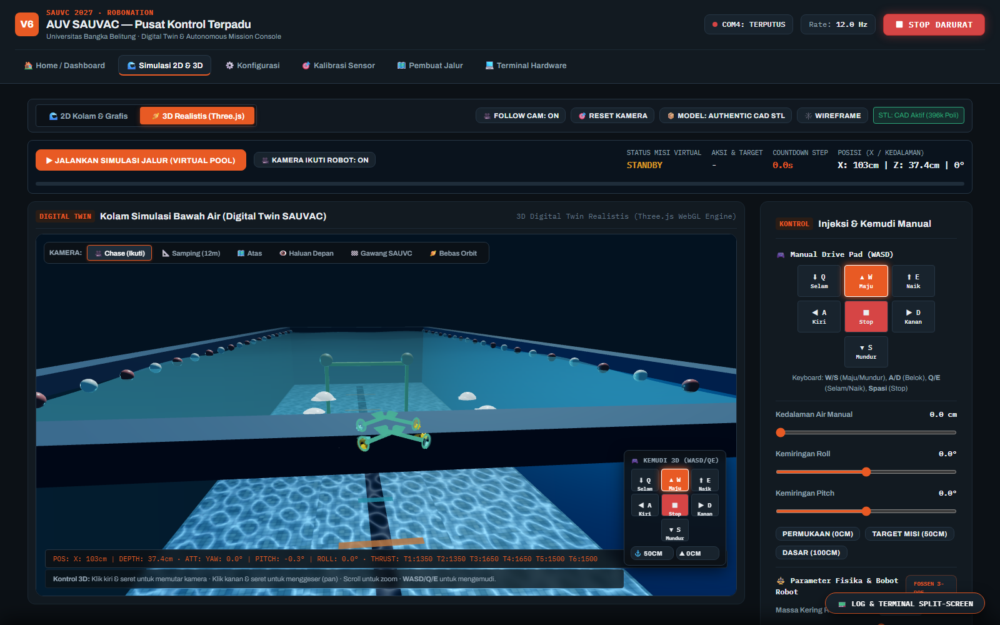
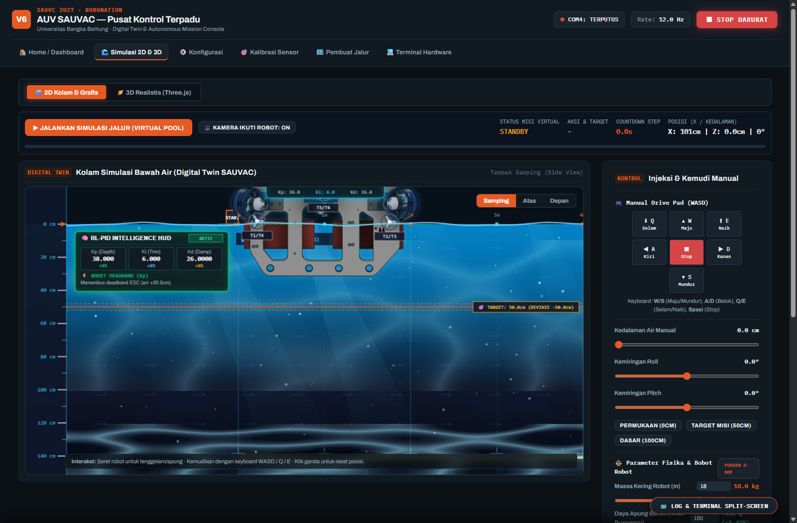
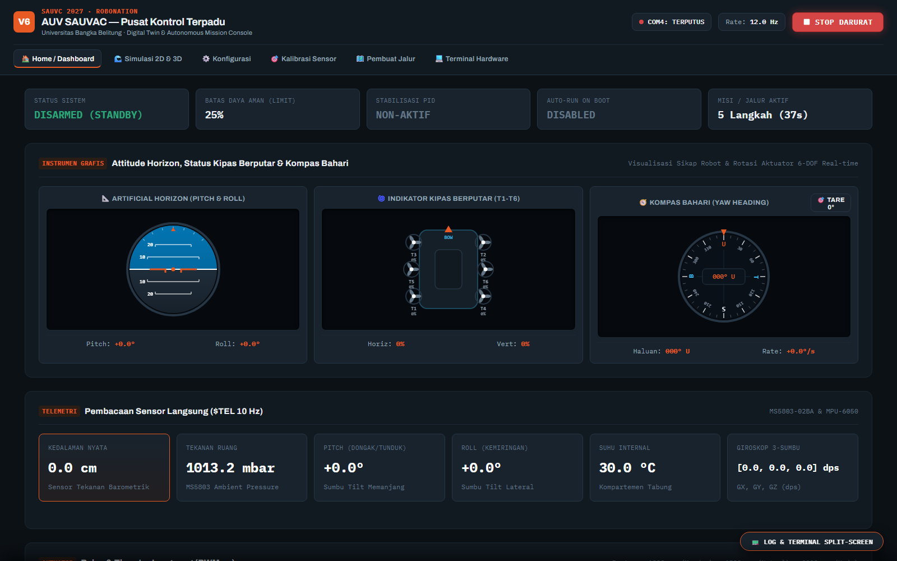
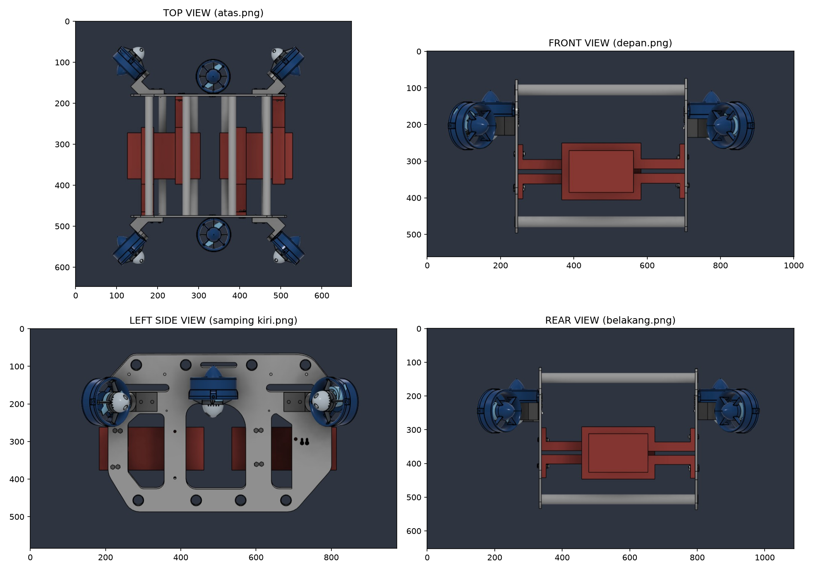

# AUV SAUVAC — 6-Thruster Precision Control & Underwater Digital Twin

<div align="center">

[-C51A4A?style=for-the-badge&logo=raspberrypi&logoColor=white)](https://www.raspberrypi.com/products/raspberry-pi-pico/)
[](https://sauvc.org/)
[](simulasi_auv/)
[](simulasi_auv/)
[-success?style=for-the-badge&logo=platformio&logoColor=white)](firmware/)

**Precision 6-Thruster Control Firmware & Underwater Digital Twin Simulation Suite**

---

### 🌐 Language
**English** • [**Bahasa Indonesia**](README.id.md)

---

</div>

## 📸 Visual Showcase

<div align="center">

| 3D Digital Twin (Three.js & CAD Mesh) | 2D Fossen Hydrodynamics & Wave Engine |
| :---: | :---: |
|  |  |

| Industrial Web Dashboard & Telemetry | Authentic CAD Projections |
| :---: | :---: |
|  |  |

</div>

---

### Table of Contents
- [System Overview](#system-overview)
- [Key Features](#key-features)
- [Hardware Pinout & Thruster Geometry](#hardware-pinout--thruster-geometry)
- [Digital Twin Simulation Guide](#digital-twin-simulation-guide)
- [Serial CLI Command Reference](#serial-cli-command-reference)
- [Autonomous Mission Format (`/jalur.json`)](#autonomous-mission-format-jalurjson)
- [Testing & Flashing Tools](#testing--flashing-tools)
- [Repository Directory Structure](#repository-directory-structure)

---

## 📌 System Overview
This project implements a **hierarchical dual-rate control architecture**:
1. **Embedded Fast-Loop (RP2040 @ 50 Hz / 20 ms):** Deterministic bare-metal C++ microcontroller firmware completely stripped of Wi-Fi/web server overhead, dedicating 100% of clock cycles to microsecond-accurate PWM generation, sensor fusion (MPU-6050 & MS5803), closed-loop PID attitude stabilization, and LittleFS autonomous mission execution.
2. **Companion Digital Twin (Host PC @ 60 FPS / Port 8080):** Interactive web-based 2D/3D Fossen hydrodynamic simulator supporting both standalone SIL (*Software-in-the-Loop*) and live HIL (*Hardware-in-the-Loop* via USB serial `COM4 @ 115200 baud`).

---

## 🌟 Key Features
1. **Deterministic 50 Hz Control Loop:** Zero network jitter ensures ESC PWM pulses remain active and uninterrupted.
2. **6-Thruster Vectored Layout:** 4 horizontal thrusters at 45° angles (X-vector) for surge, sway, and yaw, plus 2 vertical thrusters for heave, pitch, and roll.
3. **Nonlinear Fossen Hydrodynamic Physics:** Models dry mass ($14.5\text{ kg}$), added mass, quadratic drag, metacentric righting moments, positive net buoyancy (+150g fail-to-float safety), and Airy linear wave disturbances.
4. **Closed-Loop PID Attitude Stabilization:** Active stabilization for *Depth Hold*, *Roll Leveling*, and *Pitch Leveling*.
5. **LittleFS Mission Trajectory Engine:** Executes scripted `/jalur.json` missions with support for English and Indonesian navigation aliases (`dive`, `forward`, `backward`, `turn`, `sway_left`, `sway_right`, `hover`, `surface`).
6. **Hardware Protection & Failsafes:** Global **25% default power ceiling** for bench safety, ESC deadband jump compensation ($25\ \mu\text{s}$), and 500 ms serial watchdog failsafe.

---

## 🔌 Hardware Pinout & Thruster Geometry

```text
                    ▲ [NOSE / FORWARD]
                    │
      [T3: Front-Left]  ╲            ╱ [T2: Front-Right]
         (GP4, CCW)      ╲          ╱     (GP3, CW)
                          ┌────────┐
        [T6: Vert-Left]   │ RP2040 │  [T5: Vert-Right]
           (GP7, CW)      │ PICO W │     (GP6, CCW)
                          └────────┘
      [T1: Rear-Left]   ╱          ╲ [T4: Rear-Right]
          (GP2, CW)    ╱            ╲    (GP5, CCW)
                    │
                    ▼ [STERN / AFT]
```

| Component / Actuator | RP2040 GPIO | Polarity / Rotation | Function / Role |
| :--- | :---: | :---: | :--- |
| **Thruster 1 (T1)** | **GP2** | CW (Reverse: 1) | Horizontal vector rear-left (45°), surge/yaw |
| **Thruster 2 (T2)** | **GP3** | CW (Reverse: 1) | Horizontal vector front-right (45°), surge/yaw |
| **Thruster 3 (T3)** | **GP4** | CCW (Reverse: 0) | Horizontal vector front-left (45°), surge/yaw |
| **Thruster 4 (T4)** | **GP5** | CCW (Reverse: 0) | Horizontal vector rear-right (45°), surge/yaw |
| **Thruster 5 (T5)** | **GP6** | CCW (Reverse: 0) | Vertical heave mid-right, heave/depth, roll trim |
| **Thruster 6 (T6)** | **GP7** | CW (Reverse: 1) | Vertical heave mid-left, heave/depth, roll trim |
| **I2C SDA** | **GP26** | Standard I2C Wire1 | MPU-6050 (0x68) & MS5803 (0x76) sensors |
| **I2C SCL** | **GP27** | Standard I2C Wire1 | MPU-6050 (0x68) & MS5803 (0x76) sensors |
| **Serial CLI / Telemetry** | **USB** | 115200 baud, 8-N-1 | Interactive CLI & machine packets `$TEL`/`$INJ` |

---

## 🌊 Digital Twin Simulation Guide
The `simulasi_auv/` directory contains the companion server and Three.js 3D interface:
```bash
# Launch the simulation suite
cd simulasi_auv

# Option 1 (Windows Batch):
start.bat

# Option 2 (Direct Python):
python app.py
```
Open your browser at **`http://localhost:8080`**. The interface provides 6 control tabs:
* **🏠 Home / Dashboard:** Live attitude telemetry, depth, pressure, 6-thruster PWM meters, and arming state.
* **🌊 Simulasi 2D & 3D:** Three.js competition pool ($12\text{m} \times 5\text{m} \times 2\text{m}$) with PVC gate, dynamic thrust arrows, animated caustics, and 2D Fossen physics canvas.
* **⚙️ Konfigurasi:** Actuator trim settings, ESC deadband, thruster reverse flags, and PID gains.
* **🎯 Kalibrasi Sensor:** One-touch zero depth tare and IMU leveling calibration.
* **🗺️ Pembuat Jalur:** Visual waypoint trajectory designer with direct serial upload to LittleFS.
* **💻 Terminal Hardware:** Web serial ANSI terminal connected directly to the RP2040.

---

## ⚡ Serial CLI Command Reference
Connect any serial terminal at **115200 baud**:
* `status` / `stat`: Displays complete system dashboard.
* `sensor stream`: Streams live attitude and depth data (press any key to stop).
* `telem on [hz]`: Enables non-blocking `$TEL` machine telemetry packets (default: 10 Hz).
* `tes <1-6|all> <power>`: Spins motor(s) for 2.0s at specified power percentage.
* `esc calib`: Runs automated 3-phase ESC throttle calibration (2000µs $\to$ 1000µs $\to$ 1500µs).
* `calib zero`: Locks current atmospheric pressure as surface depth reference (0 cm).
* `calib level`: Zeroes IMU tilt offsets (0.0°/0.0°).
* `pid on` / `pid off`: Enables or disables active closed-loop stabilization.
* `pid <axis> <kp> <ki> <kd>`: Sets PID constants for `depth`, `roll`, or `pitch`.
* `save`: Commits settings and calibrations to EEPROM with FNV-1a checksum.
* `stop`: **EMERGENCY STOP**, immediately neutralizes all thrusters to 1500 µs.

---

## 🗺️ Autonomous Mission Format (`/jalur.json`)
Trajectories are stored in onboard LittleFS:
```json
[
  {"step": 1, "name": "Dive to 50 cm", "action": "DIVE", "power": 15, "duration": 5.0, "target_cm": 50.0, "motors": [5, 6]},
  {"step": 2, "name": "Forward Cruise", "action": "MAJU", "power": 20, "duration": 12.0, "target_cm": 50.0, "motors": [1, 2, 3, 4, 5, 6]},
  {"step": 3, "name": "Heading Turn Right", "action": "PUTAR", "power": 15, "duration": 4.0, "target_cm": 50.0, "motors": [1, 2, 3, 4, 5, 6]},
  {"step": 4, "name": "Return Forward", "action": "MAJU", "power": 20, "duration": 12.0, "target_cm": 50.0, "motors": [1, 2, 3, 4, 5, 6]},
  {"step": 5, "name": "Surface to Zero", "action": "SURFACE", "power": 15, "duration": 4.0, "target_cm": 0.0, "motors": [5, 6]}
]
```

---

## 🛠️ Testing & Flashing Tools
The [`tools/`](tools/) folder provides cross-platform Python utilities:
```bash
# Automated flash and functional regression test
python tools/flash_and_verify.py

# Test EEPROM schema v6 and sensor injection
python tools/flash_and_test_v6.py

# Verify live serial commands without re-flashing
python tools/verify_all.py
```

Build with PlatformIO CLI:
```bash
pio run              # Compile C++ firmware
pio run -t upload    # Upload to Pico W via USB
pio device monitor -b 115200 # Open serial monitor
```

---

## 📂 Repository Directory Structure
```text
auv-6thruster-rev-0.1/
├── platformio.ini                # PlatformIO build configuration for RP2040 Pico W
├── README.md                     # Main documentation in English (this file)
├── README.id.md                  # Dokumentasi bahasa Indonesia
├── .gitignore                    # Clean git ignore rules
│
├── src/                          # RP2040 C++ firmware source code
│   ├── config.h                  # EEPROM schemas, pinouts, mixer matrix
│   ├── main.cpp                  # 50 Hz control loop, FSM, and PID stabilization
│   ├── sensors.h / sensors.cpp   # MPU-6050 & MS5803 drivers & HIL injection
│   ├── mission.h / mission.cpp   # LittleFS /jalur.json autonomous trajectory engine
│   └── cli.h / cli.cpp           # ANSI terminal CLI & isolated machine protocol
│
├── firmware/                     # Verified binary files
│   ├── firmware_rev0.1.uf2       # USB BOOTSEL drag-and-drop binary (835 KB)
│   └── firmware_rev0.1.bin       # Direct binary flashing file (417 KB)
│
├── simulasi_auv/                 # Digital Twin & Web Control Center
│   ├── app.py                    # Companion Python server & serial bridge (Port 8080)
│   ├── rl_agent.py               # Adaptive RL-PID tuning module
│   ├── index.html                # 6-tab industrial dark theme web dashboard
│   ├── hydrodynamics.js          # 2D Fossen physics & Airy wave engine
│   ├── sim3d.js                  # Three.js 3D underwater simulation
│   ├── start.bat                 # One-click Windows launcher
│   ├── assets/                   # Authentic CAD STL 3D model & robot sprites
│   └── libs/                     # Three.js r128, OrbitControls, STLLoader
│
├── tools/                        # Flashing & testing utilities
│   ├── flash_and_verify.py       # Primary automated flash & test script
│   ├── flash_and_test_v6.py      # Schema v6 regression test
│   └── verify_all.py             # Active serial test runner
│
└── docs/                         # Documentation assets
    └── images/                   # High-resolution preview screenshots
```
